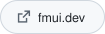
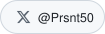
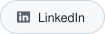

  <picture>
      <source media="(prefers-color-scheme: dark)" srcset="./assets/hero-dark.svg">
      
    </picture>

  <picture>
      <source media="(prefers-color-scheme: dark)" srcset="./assets/activity-dark.svg">
      
    </picture>

  <a href="https://github.com/Kakahaja07?tab=repositories&sort=updated">
    <picture>
      <source media="(prefers-color-scheme: dark)" srcset="./assets/repos-dark.svg">
      
    </picture>
  </a>

  <a href="https://hiprashant.com/">
    <picture>
      <source media="(prefers-color-scheme: dark)" srcset="./assets/btn-site-dark.svg">
      
    </picture>
  </a>
  <a href="https://fmui.dev/">
    <picture>
      <source media="(prefers-color-scheme: dark)" srcset="./assets/btn-fmui-dark.svg">
      
    </picture>
  </a>
  <a href="https://worldkit.in">
    <picture>
      <source media="(prefers-color-scheme: dark)" srcset="./assets/btn-worldkit-dark.svg">
      
    </picture>
  </a>
  <a href="https://x.com/Prsnt50">
    <picture>
      <source media="(prefers-color-scheme: dark)" srcset="./assets/btn-x-dark.svg">
      
    </picture>
  </a>
  <a href="https://www.linkedin.com/in/prsntseo">
    <picture>
      <source media="(prefers-color-scheme: dark)" srcset="./assets/btn-linkedin-dark.svg">
      
    </picture>
  </a>

<!-- Cards are generated by scripts/build_profile.py and refreshed daily by .github/workflows/profile.yml -->
